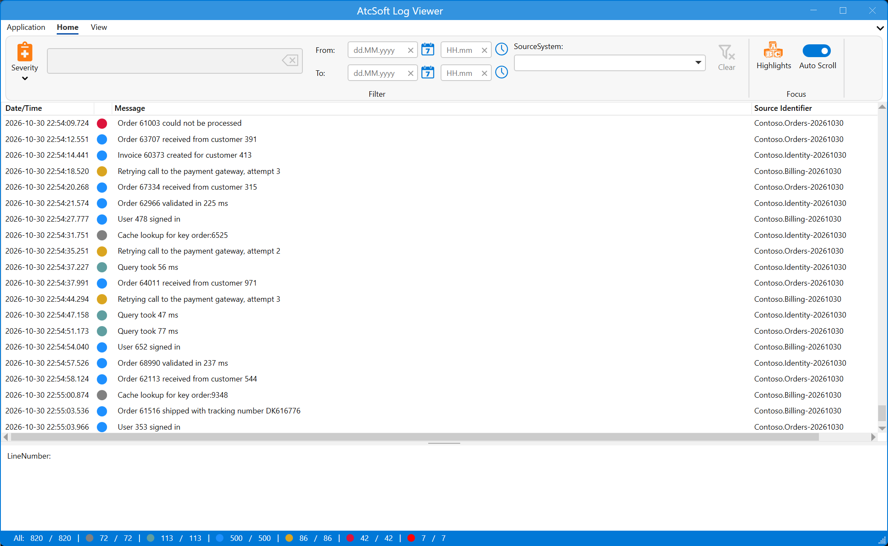
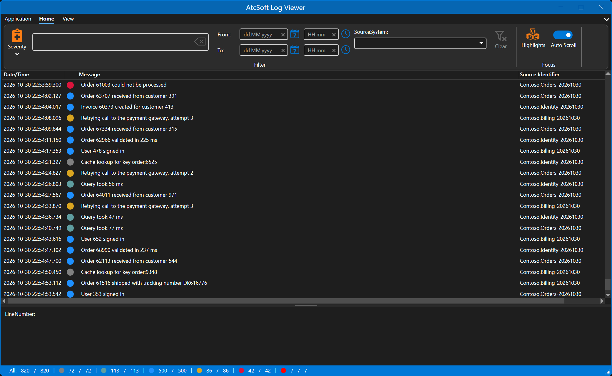
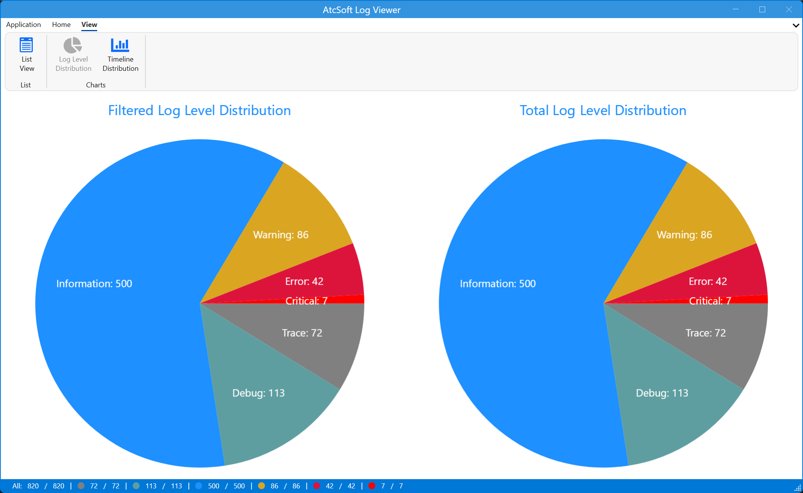
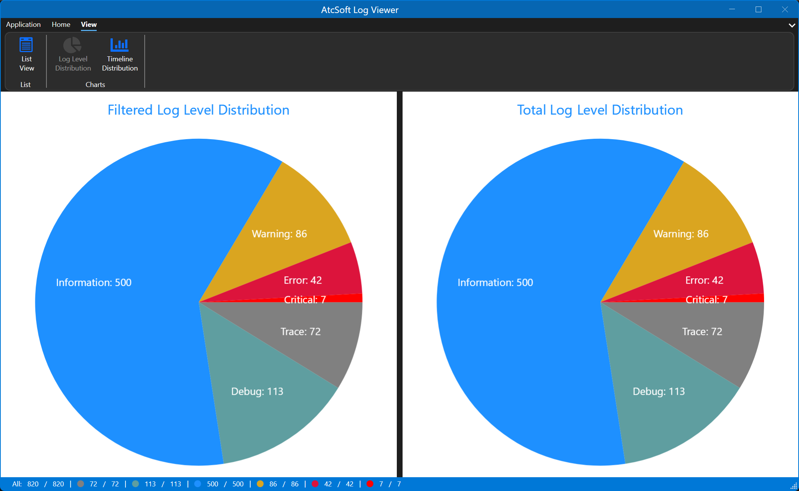
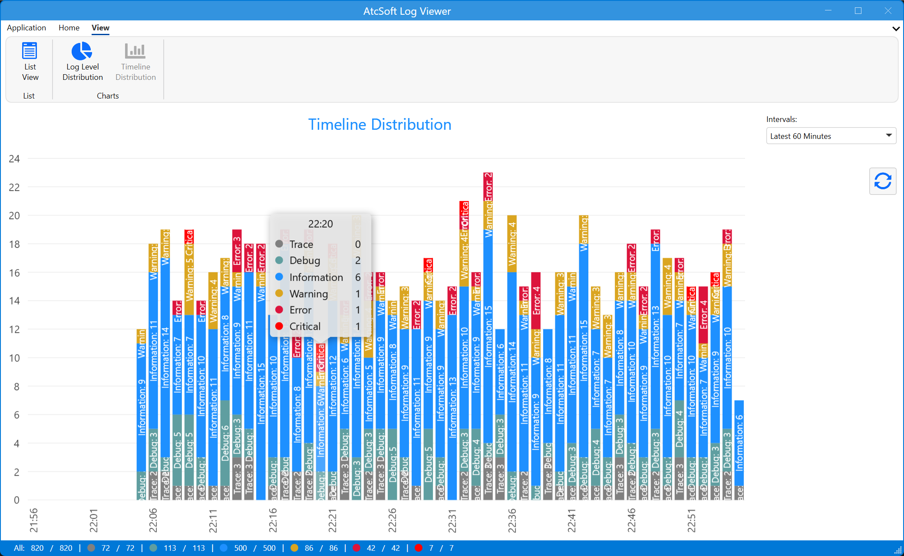
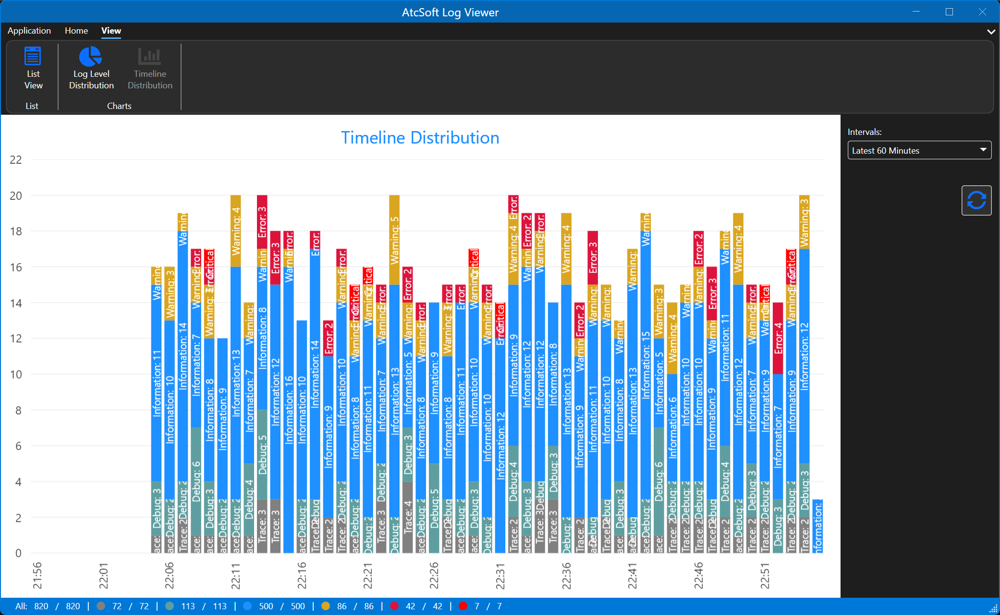

# 📜 ATC Log Viewer

[](https://github.com/atc-net-apps/atc-soft-log-viewer/actions/workflows/build.yml)
[](LICENSE)
[](https://dotnet.microsoft.com/)


ATC Log Viewer (`AtcSoft.Log.Viewer`) is a free, open source Windows app for reading log files from **log4net**, **NLog** and **Serilog**. It follows files live while they are written, filters, highlights and shows charts.

> 🚚 **Moved here:** this repo replaces the retired `atc-net/atc-logviewer`. The parsing is done by the `Atc.LogFiles.Collector` and `Atc.LogFiles.Analyzer` libraries in this repo - see [how to use them](docs/log-files-libraries.md).

## 📥 Install

Download `AtcSoft.Log.Viewer.Installer.msi` from the [latest release](https://github.com/atc-net-apps/atc-soft-log-viewer/releases/latest) and run it.

* 📁 It installs to `C:\Program Files\AtcSoft\Log Viewer`, with a Start menu and a desktop shortcut. It needs admin rights.
* 🧩 It needs the [.NET 10 Desktop Runtime](https://dotnet.microsoft.com/download/dotnet/10.0) (x64).
* ⬆️ A newer MSI upgrades the installed version. Your profiles and settings are kept: they live in your user folder, see [where the app keeps its data](#-where-the-app-keeps-its-data).

## ✨ Features

| Area | Feature | Description |
|------|---------|-------------|
| **Open** | 📂 **Open a log folder** | Pick a folder (`Ctrl+O`). The format (log4net, NLog or Serilog) is found by itself |
| | 🖱️ **Drag and drop** | Drop files and folders from Windows Explorer; they are added to what is already open |
| | 🗂️ **Profiles** | Save a log folder, format, highlights and file settings as a profile: new (`Ctrl+N`), open (`Ctrl+P`), edit, save (`Ctrl+S`) |
| | 🕘 **Recent files** | Open the last used profile (`Ctrl+R`), or let the app open it at start |
| | ⚙️ **File settings** | Per profile: how many days back to read, whether to follow the files, and file name terms to pick only some files |
| **Live** | 📡 **Live tail** | New lines show up while the files are written - also when a file is rolled by rename, or truncated |
| | 🆕 **New files** | New files that show up in the folder are picked up |
| | 🧾 **Multi-line entries** | Stack traces and other lines that belong to one entry stay together |
| | ⬇️ **Auto scroll** | Keep the list scrolled to the newest entry, or turn it off to read |
| | ⚠️ **Not read warning** | The status bar says when lines or files in the folder are in another format and were not read, for example "Not read: 3 lines, 2 files"; the tooltip names the files with an example line |
| **Filter** | 🚦 **Severity** | Show or hide Trace, Debug, Info, Warning, Error and Critical |
| | 🔍 **Text** | Show only entries whose message contains a text (press `Enter`; casing is ignored) |
| | 📅 **Date range** | Show only entries between a **From** and a **To** time |
| | 🏷️ **Source system** | Show only entries from one source |
| | 🎯 **From the list** | Right-click an entry to filter on its message, or to use its time as **From** or **To** |
| **Focus** | 🎨 **Highlights** | Color entries that contain a text: foreground, background, ignore casing - saved in the profile |
| | 📋 **Copy** | Copy a message with `Ctrl+C` or the right-click menu |
| | 🔎 **Details** | The full message and line number of the selected entry; JSON messages are shown in a JSON viewer |
| **Charts** | 🥧 **Log level distribution** | Two pie charts: the shown entries and all entries |
| | 📈 **Timeline distribution** | Entries over time per log level: the latest 60 minutes, or 12, 24 or 48 hours |
| | 🔢 **Status bar** | Shown and total counts, in all and per log level |
| **App** | 🌗 **Light and dark mode** | Pick the theme in **Application settings** |
| | 🔔 **Check for updates** | At start, the app checks the latest GitHub release and shows a notice above the log when a newer version is out. **Check for updates** in the **Application** menu shows the versions and downloads the installer |
| | ℹ️ **About** | Version and credits |

## 🖼️ Screenshots

| ☀️ Light mode | 🌙 Dark mode |
|---------------|--------------|
| List mode  | List mode  |
| Graph: Log Level Distribution  | Graph: Log Level Distribution  |
| Graph: Timeline Distribution  | Graph: Timeline Distribution  |

## 🧪 Try it with the log simulator

The [log simulator](sample/README.md) writes log files, rolls them in three ways, writes bursts and deletes files, so you can watch the viewer keep up. An Aspire AppHost starts both the simulator and the viewer:

```powershell
dotnet run --project sample/AtcSoft.Log.Viewer.Sample.AppHost
```

Small sample files for each format are in [`sample-data/`](sample-data).

## 📊 Microsoft ILogger log levels

| LogLevel    | Value | Method         | Description       |
|-------------|-------|----------------|-------------------|
| Trace       | 0     | LogTrace       | Contain the most detailed messages. These messages may contain sensitive app data. These messages are disabled by default and should not be enabled in production. |
| Debug       | 1     | LogDebug       | For debugging and development. Use with caution in production due to the high volume. |
| Information | 2     | LogInformation | Tracks the general flow of the app. May have long-term value. |
| Warning     | 3     | LogWarning     | For abnormal or unexpected events. Typically includes errors or conditions that don't cause the app to fail. |
| Error       | 4     | LogError       | For errors and exceptions that cannot be handled. These messages indicate a failure in the current operation or request, not an app-wide failure. |
| Critical    | 5     | LogCritical    | For failures that require immediate attention. Examples: data loss scenarios, out of disk space. |
| None        | 6     |                | Specifies that no messages should be written. |

## 📄 Supported log formats

The app finds the format of a file or folder by itself. These are the default layouts it reads.

### 🪵 log4net

* [Project page to log4net](https://logging.apache.org/log4net/)
* [Github link to log4net](https://github.com/apache/logging-log4net)

#### Supported layout

```csharp
layout = "%date [%thread] %-5level %logger - %message%newline%exception"
```

```text
2024-02-16 09:15:01,123 [8] INFO  Root - Application Start
2024-02-16 09:15:03,456 [8] DEBUG ModuleLoader - Loading modules
2024-02-16 09:15:04,789 [8] INFO  ModuleA - Module A initialized
2024-02-16 09:15:05,012 [8] DEBUG ModuleB - Module B initialization started
2024-02-16 09:15:05,234 [8] INFO  ModuleB - Module B initialized
2024-02-16 09:15:06,345 [8] WARN  ModuleC - Module C is deprecated
2024-02-16 09:15:07,456 [8] INFO  ModuleC - Module C initialized anyway
2024-02-16 09:15:08,567 [8] DEBUG DatabaseConnection - Attempting connection to database
2024-02-16 09:15:09,678 [8] ERROR DatabaseConnection - Database connection failed due to timeout
2024-02-16 09:15:10,789 [8] INFO  DatabaseRetry - Retrying database connection
2024-02-16 09:15:11,890 [8] DEBUG DatabaseConnection - Database connection attempt 2
2024-02-16 09:15:12,901 [8] INFO  Database - Database connected
2024-02-16 09:15:13,012 [8] WARN  SystemCheck - Low disk space
2024-02-16 09:15:14,123 [8] ERROR FileSave - Failed to save file due to disk quota exceeded
2024-02-16 09:15:15,234 [8] INFO  UserAuth - User login attempt
2024-02-16 09:15:16,345 [8] INFO  UserAuth - User logged in successfully
2024-02-16 09:15:17,456 [8] DEBUG SessionManager - Session started for user: User123
2024-02-16 09:15:18,567 [8] WARN  SessionManager - User session already active
2024-02-16 09:15:19,678 [8] INFO  HealthCheck - Application health check OK
2024-02-16 09:15:20,789 [8] INFO  Root - Application End
```

### 📘 NLog

* [Project page to NLog](https://nlog-project.org)
* [Github link to NLog](https://github.com/NLog/NLog)

#### Supported layout

```csharp
layout = "${longdate} ${uppercase:${level}} ${message:withexception=true}"
```

```text
2024-02-16 09:15:01.1231 INFO Application Start
2024-02-16 09:15:03.4562 DEBUG Loading modules
2024-02-16 09:15:04.7893 INFO Module A initialized
2024-02-16 09:15:05.0124 DEBUG Module B initialization started
2024-02-16 09:15:05.2345 INFO Module B initialized
2024-02-16 09:15:06.3456 WARN Module C is deprecated
2024-02-16 09:15:07.4567 INFO Module C initialized anyway
2024-02-16 09:15:08.5678 DEBUG Attempting connection to database
2024-02-16 09:15:09.6789 ERROR Database connection failed
2024-02-16 09:15:10.7891 INFO Retrying database connection
2024-02-16 09:15:11.8902 DEBUG Database connection attempt 2
2024-02-16 09:15:12.9013 INFO Database connected
2024-02-16 09:15:13.0124 WARN Low disk space
2024-02-16 09:15:14.1235 ERROR Failed to save file
2024-02-16 09:15:15.2346 INFO User login attempt
2024-02-16 09:15:16.3457 INFO User logged in successfully
2024-02-16 09:15:17.4568 DEBUG Session started for user
2024-02-16 09:15:18.5679 WARN User session already active
2024-02-16 09:15:19.6781 INFO Application health check OK
2024-02-16 09:15:20.7892 INFO Application End
```

### 📗 Serilog

* [Project page to Serilog](https://serilog.net)
* [Github link to Serilog](https://github.com/serilog/serilog)

#### Supported layout

```csharp
layout = "{Timestamp:yyyy-MM-dd HH:mm:ss.fff zzz} [{Level:u3}] {Message}{NewLine}{Exception}"
```

```text
2024-02-16 09:15:01.123 [INF] Application Start
2024-02-16 09:15:03.456 [DBG] Loading modules
2024-02-16 09:15:04.789 [INF] Module A initialized
2024-02-16 09:15:05.012 [DBG] Module B initialization started
2024-02-16 09:15:05.234 [INF] Module B initialized
2024-02-16 09:15:06.345 [WRN] Module C is deprecated
2024-02-16 09:15:07.456 [INF] Module C initialized anyway
2024-02-16 09:15:08.567 [DBG] Attempting connection to database
2024-02-16 09:15:09.678 [ERR] Database connection failed: "Connection timeout"
2024-02-16 09:15:10.789 [INF] Retrying database connection
2024-02-16 09:15:11.890 [DBG] Database connection attempt 2
2024-02-16 09:15:12.901 [INF] Database connected
2024-02-16 09:15:13.012 [WRN] Low disk space
2024-02-16 09:15:14.123 [ERR] Failed to save file: "Disk quota exceeded"
2024-02-16 09:15:15.234 [INF] User login attempt
2024-02-16 09:15:16.345 [INF] User logged in successfully
2024-02-16 09:15:17.456 [DBG] Session started for user: "User123"
2024-02-16 09:15:18.567 [WRN] User session already active
2024-02-16 09:15:19.678 [INF] Application health check OK
2024-02-16 09:15:20.789 [INF] Application End
```

#### LogLevel mapping between Serilog and ILogger

| ILogger        |  Serilog      |
|----------------|---------------|
| ***Trace***    | ***Verbose*** |
| Debug          | Debug         |
| Information    | Information   |
| Warning        | Warning       |
| Error          | Error         |
| ***Critical*** | ***Fatal***   |
| *None*         | *None*        |

> 💡 Note: Log-level `Trace` vs `Verbose` and `Critical` vs `Fatal`.

## 💾 Where the app keeps its data

Profiles, recent files and custom application settings are stored per user in `%LOCALAPPDATA%\AtcSoft\AtcSoft.Log.Viewer`.

Set the environment variable `ATCSOFT_LOGVIEWER_DATA_PATH` to use another folder. Set `ATCSOFT_LOGVIEWER_SKIP_UPDATE_CHECK=1` to turn off the update check at start.

Earlier versions stored them machine-wide in `%ProgramData%\ATC\atc-logviewer`. On first start, that folder is copied to the new location once. The old folder is left as it is.

## 🛠️ Build and run

Requirements: Windows and the .NET 10 SDK.

```powershell
dotnet build AtcSoft.Log.Viewer.slnx -c Release
dotnet test --solution AtcSoft.Log.Viewer.slnx -c Release
dotnet run --project src/AtcSoft.Log.Viewer.Wpf.App -c Release
```

## ✅ Tests and benchmarks

* 🧪 **Unit tests** for the libraries, the app core, the sample generator and the simulator run with `dotnet test` (see above).
* 🖥️ **UI tests** that drive the real app exist and are turned on with `ATCSOFT_E2E=1` - see [UI tests](docs/e2e-tests.md).
* ⚡ **Benchmarks** for collecting and filtering are in `benchmark/Atc.LogFiles.Benchmarks` (BenchmarkDotNet).
* 🏭 **Big sample files** for load testing are written by the [sample generator](tool/Atc.LogFiles.SampleGenerator/README.md).

## 🏗️ Project layout

| Project | What |
|---|---|
| `src/AtcSoft.Log.Viewer` | App core without UI: data paths, the migration of earlier data, the profile format, timeline modes and the update check |
| `src/AtcSoft.Log.Viewer.Wpf` | The WPF front end: views and view models |
| `src/AtcSoft.Log.Viewer.Wpf.App` | The exe: starts the app and shows the main window |
| `src/Atc.LogFiles.Collector` | Reads and tails log4net, NLog and Serilog files (pure C#, no reference to the app) |
| `src/Atc.LogFiles.Analyzer` | Combines collectors; filters, counts, highlight matching, timeline buckets, and watching the folder for new files (pure C#, no reference to the app) |
| `setup/AtcSoft.Log.Viewer.Installer` | The WiX MSI. The release workflow builds it and attaches it to each GitHub release |
| `sample/Atc.LogFiles.Simulator` | Web page that writes, rolls and deletes log files, see the [sample README](sample/README.md) |
| `sample/AtcSoft.Log.Viewer.Sample.AppHost` | Aspire AppHost that starts the simulator and the viewer |
| `test/AtcSoft.Log.Viewer.Tests` | Tests for the core |
| `test/Atc.LogFiles.*.Tests` | Tests for the libraries, the sample generator and the simulator |
| `test/AtcSoft.Log.Viewer.E2E.Tests` | UI tests that drive the app, the simulator page and the AppHost, see [UI tests](docs/e2e-tests.md) |
| `tool/Atc.LogFiles.SampleGenerator` | Writes big sample log files for testing, see its [README](tool/Atc.LogFiles.SampleGenerator/README.md) |
| `benchmark/Atc.LogFiles.Benchmarks` | BenchmarkDotNet benchmarks for collecting and filtering |

## 📚 Documentation

| Document | Description |
|----------|-------------|
| [📦 Atc.LogFiles libraries](docs/log-files-libraries.md) | Read, filter, count, highlight and build a timeline in your own code |
| [🧪 Log simulator](sample/README.md) | Watch the viewer follow files that are written, rolled and deleted |
| [🖥️ UI tests](docs/e2e-tests.md) | End-to-end tests that drive the app |
| [🏭 Sample generator](tool/Atc.LogFiles.SampleGenerator/README.md) | Write big sample log files |
